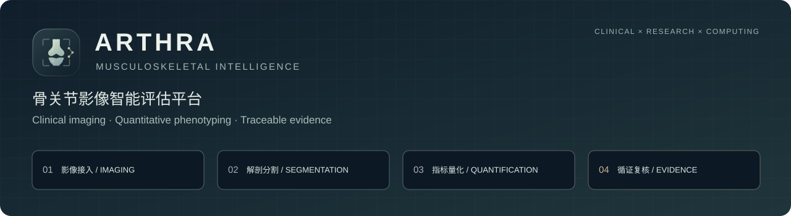
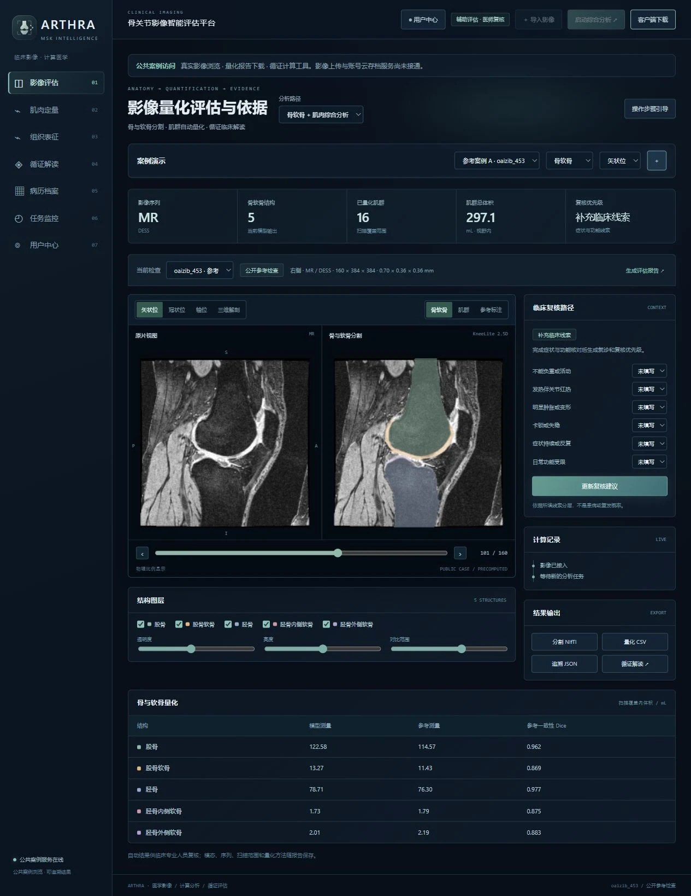
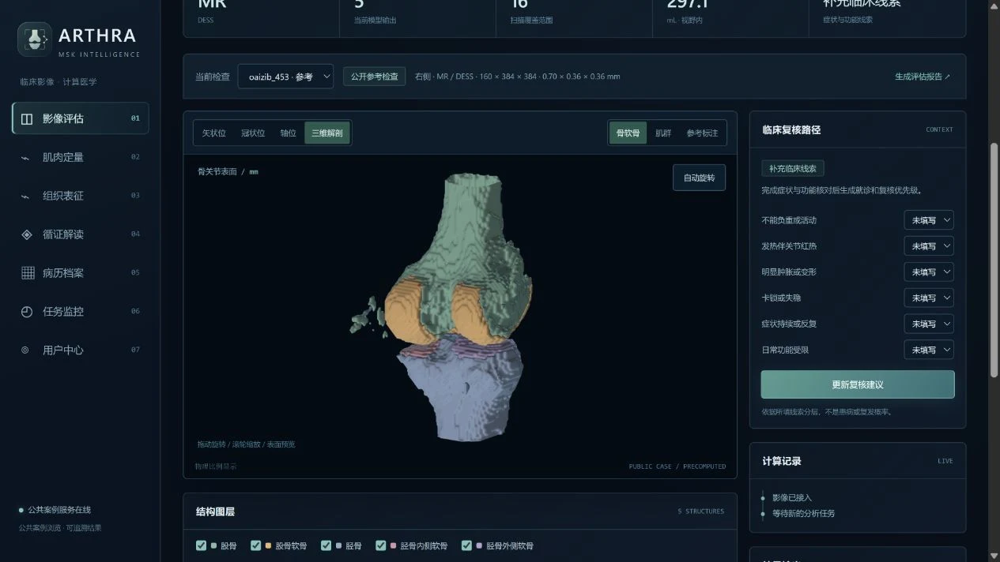
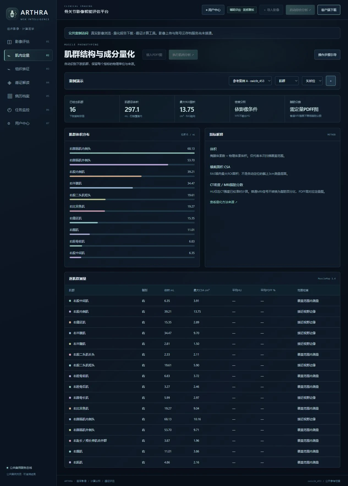
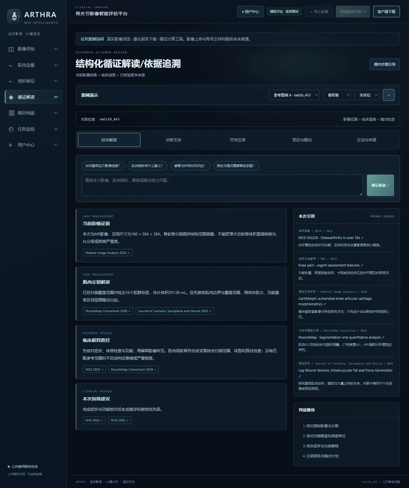
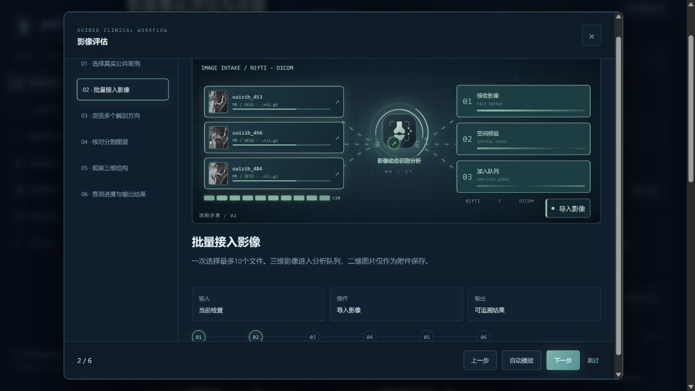
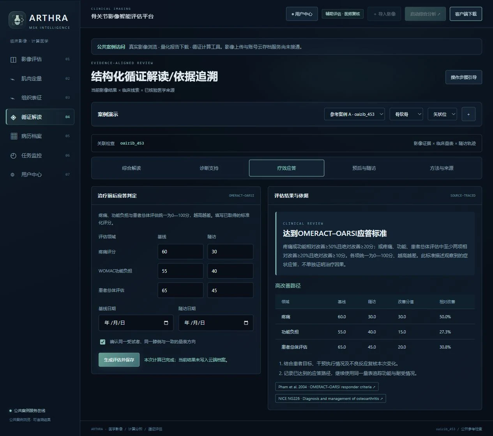
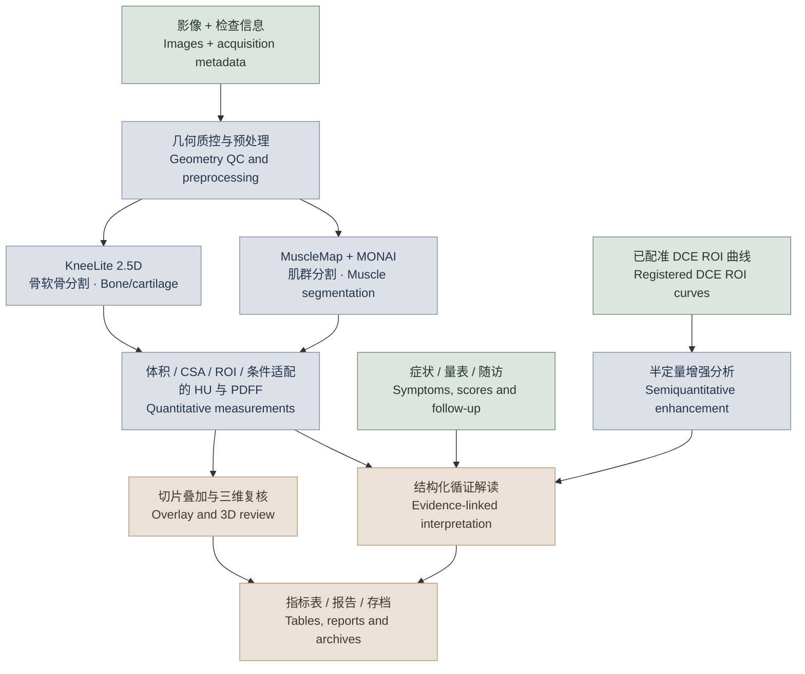
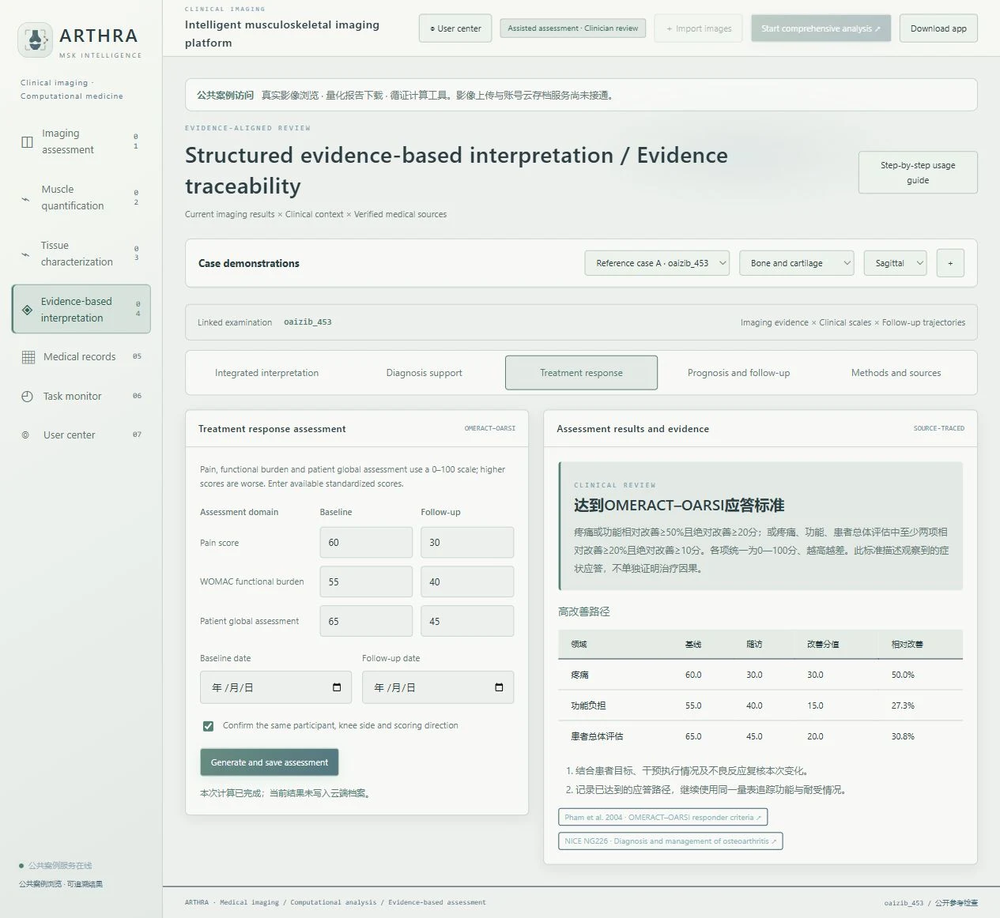

  

<strong>看清骨与软骨，量化肌肉与组织，连接临床应答与随访。</strong> 
Visualize anatomy. Quantify tissues. Connect imaging with clinical response and follow-up.

<a href="https://arthra-clinical.robust-bison-1426.chatgpt.site/">🌐 在线体验 / Explore ARTHRA</a> ·
<a href="#capabilities">核心能力 / Capabilities</a> ·
<a href="#clinical">临床与科研 / Clinical & research</a> ·
<a href="#workflow">使用流程 / Workflow</a> ·
<a href="#research">研究应用 / Research</a> ·
<a href="#technical-route">技术路线 / Methods</a>

## ARTHRA 能做什么？ · What can ARTHRA do?

**ARTHRA 骨关节影像智能评估平台**面向临床工作者、科研课题组及医学与计算机交叉研究者，以膝关节与下肢肌群为核心，将 **影像浏览、骨软骨分割、肌肉定量、组织表征、循证解读、疗效应答评估和随访趋势分析**整合到同一平台。它既能呈现原始影像和三维解剖结构，也能把分析结果转化为带单位的指标、可追溯的解释和可导出的研究资料，帮助使用者从“观察影像”进一步走向“量化结构、比较变化、理解临床意义”。

**ARTHRA** brings knee and lower-limb imaging into a connected workflow for **image review, bone and cartilage segmentation, muscle quantification, tissue characterization, evidence interpretation, treatment-response assessment and symptom follow-up**. Users can inspect images and 3D anatomy, obtain quantitative measurements, compare observations, review supporting evidence and export structured results.

 真实公共 MRI 案例：原片、分割结果与量化指标集中呈现。 A real public MRI case with images, segmentation and measurements in one view.

## 六项核心能力 · Six core capabilities

### 01 骨软骨分割与三维形态测量 · Bone/cartilage segmentation and morphometry

导入适配的三维 NIfTI 或 DICOM 影像，在矢状位、冠状位与轴位切换观察；对适用的膝关节 DESS MRI 自动分割股骨、胫骨及对应软骨，叠加展示预测边界与参考标注，并构建可旋转、缩放的三维表面。同步查看各结构体积，在有参考标注时比较分割一致性，支持从二维切片到三维解剖的连续复核。

Review compatible NIfTI or DICOM volumes in three planes. Segment femur, tibia and associated cartilage in supported knee DESS MRI, inspect overlays and reference labels, explore interactive 3D surfaces and measure structural volumes.

### 02 肌群形态与成分定量 · Muscle morphology and composition

自动识别下肢肌群，输出逐肌群的扫描覆盖内体积、最大轴向横截面积及视野边界提示。针对符合采集要求的数据，进一步计算 CT 平均衰减值或定量脂肪图的 PDFF 指标，使肌肉形态与成分信息能够以清晰的数值、单位和图表呈现。

Obtain per-muscle volume, maximum axial cross-sectional area and scan-coverage information. Compatible calibrated CT and quantitative fat-fraction maps enable additional attenuation and PDFF measurements.

<table>
<tr>
<td width="50%" valign="top">
 
<strong>从切片到三维 / From slices to 3D</strong> 分层查看骨与软骨的空间关系。 Inspect spatial relationships between bone and cartilage.
</td>
<td width="50%" valign="top">
 
<strong>从结构到指标 / From anatomy to measurements</strong> 将肌群分割转化为可导出的定量结果。 Turn muscle segmentation into exportable measurements.
</td>
</tr>
</table>

### 03 组织信号表征与纵向变化分析 · Tissue characterization and longitudinal analysis

分析感兴趣区域的信号均值、标准差、分位数与直方图；接入 DCE 时间—信号数据，计算相对增强、达峰时间、曲线下面积等半定量特征；对同一受试者、同侧别和匹配采集方案的两次结果进行比较，呈现绝对变化与相对变化，支持组织信号观察与纵向研究。

Characterize ROI signal distributions, analyze DCE time–signal curves using semiquantitative enhancement metrics, and compare matched examinations through absolute and relative changes.

### 04 临床决策支持与循证解释 · Clinical decision support and evidence interpretation

将影像测量与症状、功能量表及随访记录相结合，提供结构化循证解读、诊断路径核对、治疗应答判定和症状趋势分析。结果同时展示判断条件、变化幅度和来源链接，便于临床复核、病例讨论和课题汇报。

Combine measurements with symptoms, functional scores and follow-up observations. Review structured explanations, guideline-based diagnostic pathways, treatment-response criteria and symptom trajectories, with visible calculation logic and source links.

| 临床问题 / Clinical question | 平台能提供什么 / What ARTHRA provides |
|---|---|
| **当前信息支持怎样的诊断思路？** Which diagnostic pathway fits the available information? | 依据 NICE 骨关节炎指南，核对年龄、活动相关疼痛、晨僵和警示表现，组织需复核的临床线索。 Guideline-based review of age, activity-related pain, morning stiffness and warning signs. |
| **治疗前后是否达到应答标准？** Has an observed treatment response occurred? | 按 OMERACT–OARSI 标准比较疼痛、功能与总体评估，展示绝对改善、相对改善及对应应答路径。 Response classification with absolute and relative changes across pain, function and global assessment. |
| **症状随访呈现什么趋势？** How are symptoms changing over time? | 结合临床背景整理随访重点，对符合数据要求的 NRS 记录估计短期趋势并显示预测区间。 Follow-up priorities and short-term NRS trajectories with prediction intervals when sufficient observations are available. |
| **结论依据在哪里？** Where does the interpretation come from? | 将指标、计算规则、适用条件与指南或方法文献关联，支持直接追溯。 Measurements linked to rules, acquisition conditions, guidelines and methodological sources. |

 让指标、临床问题和证据来源处于同一阅读路径。 Measurements, clinical questions and supporting sources in a connected review.

### 05 批量影像计算与任务监测 · Batch processing and task monitoring

本机完整服务支持每批最多 10 份文件接入，通过任务监控查看上传进度、分析阶段和完成状态；分析完成后弹出通知，并提供结果下载。临床工作者可以连续处理检查资料，科研人员可以按批次组织影像分析。

The full local service accepts up to ten files per batch, displays upload and analysis progress, notifies users when processing finishes and provides downloadable results.

### 06 研究数据归档与结构化导出 · Research archiving and structured export

使用工作账号管理院校单位信息、历史分析记录与结果快照；通过病例编号查询检查并返回相应影像，随时调阅既往结果。导出 NIfTI 掩膜、CSV 指标表、JSON 记录、HTML 报告及 ZIP 存档，方便统计分析、研究复现和汇报整理。

Work accounts organize affiliation, analysis history and result snapshots. Search examinations, reopen associated images and export masks, measurement tables, structured records, reports and archives for research and review.

## 能帮助完成哪些研究？ · Research applications

平台以**定量影像表型（quantitative imaging phenotyping）**为连接点，将解剖结构、肌肉形态、组织信号与患者报告结局（patient-reported outcomes, PROs）组织成可复核的研究资料。下表说明可由现有功能支撑的研究工作，以及研究者需补充的数据与分析。

ARTHRA connects anatomical, muscle and tissue measurements with patient-reported outcomes. The study designs below distinguish platform-generated outputs from additional cohort data and statistical work.

| 研究方向 / Research direction | 具体研究问题 / Research question | 平台提供的研究资料 / Platform contribution | 研究实施 / Study design |
|---|---|---|---|
| **膝关节结构影像表型** Knee structural phenotyping | 不同受试者的骨软骨体积及解剖形态有何差异？ How do bone and cartilage measurements vary across participants? | 五类骨软骨掩膜、体积、三维表面及有参考标注时的 Dice。 Five-structure masks, volumes, surfaces and reference-based Dice. | 统一 DESS 采集与扫描范围，导出病例级指标，开展组间比较或协变量调整。 Harmonize acquisition and compare groups with appropriate covariate adjustment. |
| **肌肉—关节关联研究** Muscle–joint association studies | 肌群体积、CSA 或成分指标与疼痛、功能负担有何关联？ How do muscle measurements relate to pain and function? | 逐肌群形态与条件适配的 HU/PDFF 指标。 Per-muscle morphology and acquisition-compatible composition metrics. | 补充临床量表、年龄、性别、BMI、活动水平等变量，在 R/Python 等环境中开展相关或多变量回归分析。 Add clinical covariates and conduct association analyses externally. |
| **干预前后疗效与影像变化研究** Intervention-response studies | 康复或其他预设干预后，症状应答与肌肉指标变化是否一致？ Do symptom responses align with muscle changes after intervention? | OMERACT–OARSI 应答标签、绝对/相对改善、配对肌群指标差值。 Responder classification, score changes and paired muscle measurements. | 按方案采集基线和随访，记录干预与对照、依从性及伴随治疗；组间效应与因果分析在研究统计阶段完成。 Use protocol-defined follow-up and analyze treatment effects at study level. |
| **组织增强特征研究** Tissue-enhancement studies | 预先定义 ROI 的增强幅度和时程是否随临床状态变化？ Do ROI enhancement patterns vary with clinical state? | DCE 相对增强、TTP、相对增强曲线 AUC 及采样斜率。 Relative enhancement, TTP, enhancement AUC and sampled slopes. | 外部完成动态序列运动校正与 ROI 配准后导入时间—信号数据；平台不自动分割滑膜。 Import motion-corrected, registered ROI curves; synovial segmentation is not automated. |
| **测量重复性与算法评价** Repeatability and algorithm evaluation | 同一检查重复处理或重复扫描的测量误差有多大？ How stable are repeated measurements? | 保存掩膜、指标、扫描信息和模型版本；当前内置参考一致性指标为 Dice。 Retain masks, metrics, acquisition context and model provenance. | 配置人工参考标注或重测数据，导出后计算 ICC、Bland–Altman 一致性及重复性误差；这些统计量属于外部研究分析。 Use external ICC, agreement and repeatability analyses with suitable reference data. |
| **症状随访与预测模型准备** Follow-up and prediction-model preparation | 疼痛轨迹如何变化？哪些影像特征值得进入后续预测研究？ How do symptoms evolve, and which features merit predictive modeling? | NRS 趋势、95% 预测区间、结构化影像特征与应答结果。 NRS trajectories, prediction intervals, imaging features and response outputs. | 明确结局与预测时点，在独立研究数据中开展建模和验证；现有症状趋势模块不输出患病或结构进展概率。 Define endpoints and validate new models using independent study data. |

**与多模态研究的衔接 / Connection to multimodal research**：导出的影像特征可按去标识化研究编号，与外部采集的临床量表、实验室或血清标志物及随访结局关联，作为多模态融合研究的输入。目前平台完成的是影像特征提取、临床规则计算与结果组织；影像—血清融合模型、风险列线图和人群阈值需要独立数据建模与验证。

Exported imaging features can be linked to clinical, laboratory and outcome data through de-identified study identifiers. Multimodal fusion models and risk nomograms are subsequent research tasks, rather than built-in validated predictors.

研究设计应将**结构指标、症状改善和治疗因果**作为不同问题分别分析。DCE 膝 OA 研究说明了重复性与变化敏感性的重要性；肌肉脂肪测量研究也强调在解释纵向变化前评估测量误差。[DCE 原始研究](https://pubmed.ncbi.nlm.nih.gov/33591383/) · [肌肉脂肪重测研究](https://pmc.ncbi.nlm.nih.gov/articles/PMC6240750/)

Study protocols should distinguish structural measurements, symptom changes and causal effects, and establish repeatability before interpreting longitudinal differences.

## 为临床、科研与交叉学科提供共同界面 · A shared interface across disciplines

| 使用者 / Audience | 可以完成的工作 / Practical tasks |
|---|---|
| **临床工作者 / Clinicians** | 对照原片与分割，理解肌肉和关节结构指标，复核诊断线索，比较疗效应答，组织随访。 Review anatomy and measurements, assess clinical criteria, compare response and plan follow-up. |
| **科研课题组 / Research teams** | 提取结构化指标，比较匹配检查的变化，保存分析记录，导出研究表格和图像结果。 Extract measurements, compare matched examinations, retain records and export research outputs. |
| **医学与计算机研究者 / Medical-computing researchers** | 观察模型输出如何转化为解剖测量与临床解释，查看处理阶段及实现代码，研究分割、量化与可视化的衔接。 Explore how model predictions become measurements and interpretable outputs through visible processing stages and source inspection. |

## 一条完整的工作流程 · One connected workflow

**选择案例或接入影像 → 分割与定量 → 原片/三维复核 → 临床与循证解读 → 保存和导出**

**Select or upload → Segment and quantify → Review images and 3D anatomy → Interpret with clinical evidence → Save and export**

<table>
<tr>
<td width="50%" valign="top">
 
<strong>上手直观 / Guided interaction</strong> 分步引导、动态流程示意与公共案例选择。 Step-by-step guides, workflow animations and public cases.
</td>
<td width="50%" valign="top">
 
<strong>应答清晰 / Transparent response assessment</strong> 展示治疗前后评分变化与判定条件。图中评分为模拟示例，不代表公共影像病例的真实疗效。 Score changes and explicit criteria. Ratings are synthetic, not observed outcomes of the MRI case.
</td>
</tr>
</table>

## 工作流与技术路线 · Workflow and technical approach

### 从原始影像到研究输出 · From acquisition to research output

| 阶段 / Stage | 实现过程 / Processing | 形成的结果 / Deliverable |
|---|---|---|
| **1. 数据接入与质控** Intake and quality control | 解析 NIfTI 或单序列 DICOM；检查维度、方向、层间距、空间单位、侧别和序列适配性。 Parse volumes and verify geometry, spacing, units, laterality and sequence compatibility. | 规范化影像、检查元数据及接入记录。 Canonical images and acquisition metadata. |
| **2. 几何与强度预处理** Preprocessing | 转换到 RAS 规范方向；分别建立骨软骨与肌群推理网格，保留原始仿射矩阵和体素间距。 Canonical RAS orientation, pipeline-specific grids and preserved spatial transforms. | 可追溯的模型输入及空间映射。 Model inputs with traceable geometry. |
| **3. 分支模型推理** Model inference | 适配 DESS MRI 进入 KneeLite 2.5D 分割；肌群分析进入 MuscleMap/MONAI 滑窗推理。 KneeLite segmentation for compatible DESS MRI and MuscleMap sliding-window inference for muscles. | 解剖标签图与推理来源记录。 Label maps and model provenance. |
| **4. 定量与可视化** Quantification and visualization | 计算体积、CSA、ROI 信号及满足条件的 HU/PDFF；生成叠加切片和三维表面。 Calculate measurements and render overlays and surfaces. | 带单位的指标表、图像和三维视图。 Measurement tables, images and 3D views. |
| **5. 临床关联与变化分析** Clinical and longitudinal analysis | 输入临床线索、治疗前后评分、匹配检查或 NRS 随访；调用规则与统计计算模块。 Combine clinical features, paired scores, matched scans and NRS observations. | 诊断支持、应答判定、变化量与随访轨迹。 Diagnostic support, response classification, changes and trajectories. |
| **6. 专业复核与导出** Review and export | 对照原片检查边界、覆盖和单位；按工作账号保存快照、导出研究文件。 Review boundaries, coverage and units; save and export results. | NIfTI / CSV / JSON / HTML / ZIP。 Masks, tables, provenance, reports and archives. |

<!-- The diagram describes implemented processing branches, not a multimodal prediction network. -->

### 分割模型与实现方法 · Segmentation and implementation

**骨软骨分支：KneeLite 2.5D U-Net。** 以相邻三张矢状位切片作为三个输入通道，在二维卷积中引入层间上下文；输入平面为 192×192，输出背景及五类骨软骨结构。网络采用编码器—解码器、跳跃连接（skip connections）、Group Normalization 和 SiLU，参数量为 **274,914**。预处理使用第 1 与第 99.5 百分位进行强度裁剪和归一化；训练使用加权交叉熵（weighted cross-entropy）与前景 soft Dice 联合损失、AdamW 优化器及余弦学习率调度。结构设计参考 [U-Net 原始论文](https://arxiv.org/abs/1505.04597)，这里的轻量化配置由本项目实现。

**Bone/cartilage branch.** A 274,914-parameter encoder–decoder uses three adjacent sagittal slices as a 2.5D input, with skip connections, GroupNorm and SiLU. Training combines weighted cross-entropy and foreground soft Dice, optimized with AdamW and cosine scheduling.

**肌群分支：MuscleMap 1.4 预训练模型适配。** 使用 MONAI U-Net，在非零体素内进行 z-score 标准化；工作网格面内间距为 1×1 mm，层间距取 2 mm 与规范方向输入层间距的较大值。轴向 256×256 滑窗采用 **50% 重叠与高斯加权融合**，保留下肢肌群标签，并以最近邻插值恢复到规范方向下的原始影像网格进行定量。[MuscleMap](https://musclemap.github.io/MuscleMap/) · [MONAI 滑窗实现](https://docs.monai.io/en/1.4.0/inferers.html)

**Muscle branch.** The MuscleMap adapter uses nonzero-voxel z-score normalization, 256×256 axial windows, 50% overlap and Gaussian blending. Labels are restored with nearest-neighbor interpolation for native-grid measurements. This integration uses the segmentation model and project-specific measurements, rather than every feature of the upstream toolbox.

**可视化与结果组织。** 三维表面采用 Marching Cubes 等值面提取与 WebGL 交互显示；体积及面积直接由标签与物理空间计算，不从显示网格反推。完整服务以 Python 处理影像与计算，以浏览器界面呈现分析过程；主要实现组件为 `core.py`、`muscle_engine.py`、`tissue_analysis.py`、`clinical_support.py` 与 `server_v2.py`，这些后端组件独立于本客户端仓库部署。

**Visualization and orchestration.** Marching Cubes and WebGL support surface review. Measurements use label maps and physical geometry rather than display meshes. The separate Python backend handles image processing, clinical calculations, task state and exports.

### 指标定义与计算依据 · Measurement definitions

| 指标 / Metric | 定义与实现 / Definition | 解释要点 / Interpretation |
|---|---|---|
| **结构体积 / Volume** | $V=N_{\mathrm{ROI}}\times v_{\mathrm{voxel}}$；空间单位为 mm 时除以 1000 得 mL。肌群体素体积取仿射矩阵空间部分行列式绝对值；骨软骨采用工作网格间距。 Voxel count × physical voxel volume; muscle uses native geometry and bone/cartilage the working grid. | 对应扫描覆盖内体积；记录实际计算网格。 Report scan-covered volume and the measurement grid. |
| **最大轴向横截面积 / Maximum axial CSA** | 逐轴向层面 ROI 像素数 × 物理像素面积，取最大值，单位 cm²。 Maximum slice-wise ROI area in physical units. | 表示 RAS 轴向最大面积，不等同于固定解剖层面或垂直肌纤维的生理横截面积。 Not a fixed-landmark area or physiological CSA. |
| **肌肉 CT 衰减 / Muscle CT attenuation** | 经 HU 标定的 CT 中，计算肌肉 ROI 平均 Hounsfield units。 Mean calibrated CT attenuation within muscle labels. | 用于组织成分研究；普通 MRI 信号不能替代 HU。 Requires calibrated CT. |
| **质子密度脂肪分数 / PDFF** | 在同检查、已配准且网格一致的定量 PDFF 图上，按肌肉掩膜提取均值。 Mean PDFF from a matching quantitative map. | 纵向差值以百分点表示；常规 MRI 灰度不直接换算脂肪百分比。 Changes are percentage points, not arbitrary signal changes. |
| **一阶信号统计 / First-order signal statistics** | ROI 均值、标准差、中位数、P10、P90 与 24 区间直方图。 Mean, SD, median, percentiles and histogram. | 描述区域信号分布，当前不包括高阶纹理影像组学特征。 Distribution descriptors, not a full texture-radiomics pipeline. |
| **相对增强 / Relative enhancement** | $RE(t)=100[S(t)-S_0]/S_0$，$S_0$ 为用户指定基线采样点的平均信号。 Signal change relative to the baseline mean. | 输入来自已配准的 DCE ROI；输出为半定量信号特征。 Requires a registered DCE ROI time series. |
| **TTP / 增强 AUC / 采样斜率** | TTP 从最后一个基线点计时；AUC 对 RE 曲线作梯形积分；最大斜率取相邻采样点差分。 TTP from the last baseline sample, trapezoidal AUC and maximum sampled slope. | AUC 单位为 %·s，包含负增强；不是血流量或 $K^{trans}$。 Enhancement AUC is not a perfusion or pharmacokinetic parameter. |
| **分割重叠 / Dice** | $\mathrm{Dice}=2\lvert P\cap G\rvert/(\lvert P\rvert+\lvert G\rvert)$，逐结构比较预测与参考掩膜。 Overlap between predicted and reference labels. | 需人工参考或合法参考标注；不能解释为诊断准确率。 A segmentation metric, not diagnostic accuracy. |

PDFF 与纵向变化的研究依据见[肌肉脂肪重测研究](https://pmc.ncbi.nlm.nih.gov/articles/PMC6240750/)；DCE 定量采集和药代动力学参数的技术条件见 [RSNA QIBA](https://qibawiki.rsna.org/index.php/DCE_MRI_Biomarker_Ctte)。平台当前实现的是上表中的半定量增强指标。

### 临床规则与随访统计 · Clinical rules and follow-up statistics

- **诊断支持（guideline-based diagnostic support）**：将年龄 ≥45 岁、活动相关关节痛、无晨僵或晨僵 ≤30 分钟及警示表现组织为规则化核对，依据 [NICE NG226](https://www.nice.org.uk/guidance/NG226/chapter/recommendations)。指南中的典型 OA 临床诊断并不要求常规影像；平台的影像定量用于结构评价与研究。  
  Clinical features are reviewed against a guideline pathway; imaging quantification is a complementary structural and research tool.
- **疗效应答（OMERACT–OARSI responder criteria）**：三项输入统一为 0–100、越高越差。疼痛或功能相对改善 ≥50% 且绝对改善 ≥20 分，或疼痛、功能、总体评估中至少两项相对改善 ≥20% 且绝对改善 ≥10 分，即满足对应应答路径。[原始标准](https://doi.org/10.1016/j.joca.2004.02.001)  
  Response classification uses explicit high-improvement or combined-improvement thresholds across consistently oriented scores.
- **症状轨迹（symptom trajectory）**：对 NRS 0–10 疼痛记录采用普通最小二乘（OLS）线性拟合，输出每 30 天斜率、拟合优度 $R^2$、短期估计及单次未来观测的 95% 预测区间。要求 5–100 次记录、跨度 ≥28 天；外推不超过观察跨度的一半且最长 90 天。[NIST 预测区间方法](https://itl.nist.gov/div898/handbook/pmd/section5/pmd512.htm)  
  OLS estimates a short-term symptom trajectory with a prediction interval, subject to independent, constant-variance residual assumptions; it is not a disease-progression model.

### 已完成的模型研究 · Completed model evaluation

KneeLite 在本项目划分的 **32 例训练、8 例验证、10 例独立测试**上完成 24 轮训练；模型按验证集五结构平均 Dice 选择，测试集用于最终评估。测试结果如下，评估范围为 **192×192 工作平面、每例全部矢状位切片**。

KneeLite was trained for 24 epochs using 32 training, 8 validation and 10 held-out test cases. Checkpoint selection used validation performance; the following results cover all sagittal slices on the working grid.

| 测试结构 / Test structure | 平均 Dice / Mean Dice |
|---|---:|
| 股骨 / Femur | 0.9683 |
| 股骨软骨 / Femoral cartilage | 0.8565 |
| 胫骨 / Tibia | 0.9763 |
| 胫骨内侧软骨 / Medial tibial cartilage | 0.8446 |
| 胫骨外侧软骨 / Lateral tibial cartilage | 0.8536 |
| **五类宏平均 / Five-structure macro average** | **0.8999** |

以病例为单位进行 **2,000 次 bootstrap**，宏平均 Dice 的 95% 区间为 **0.8912–0.9093**。这是本项目小样本划分的分割结果；MuscleMap 分支目前没有匹配人工肌群标注的本地精度结果。原始数值与权重指纹见[验证记录](docs/validation-summary.json)，公共影像与标签来源见 [OAIZIB-CM](https://zenodo.org/records/14934086)。

The case-bootstrap 95% interval is 0.8912–0.9093. These are project-specific segmentation results; local muscle-accuracy estimates require matched manual reference labels.

## 适配不同设备与使用习惯 · Designed for different screens and preferences

**电脑与手机响应式布局 · 深色 / 莫兰迪浅色 / 跟随系统 · 四档字体大小 · 八种界面语言**

Responsive desktop and mobile layouts, dark and Morandi light themes, system appearance and four font sizes.

简体中文 · 繁體中文 · English · 日本語 · 한국어 · Español · Français · Deutsch

 英文与莫兰迪浅色界面；评分为模拟演示，部分动态结果与来源保留原语言。 English interface with a Morandi light theme; ratings are synthetic and some dynamic/source text retains its original language.

## 体验与资料 · Explore and learn more

**[在线体验 ARTHRA / Open the public showcase](https://arthra-clinical.robust-bison-1426.chatgpt.site/)**：浏览公共影像案例、三维结果、预计算指标及临床计算工具。新影像上传推理、工作账号和私有存档由独立的本机完整服务提供；本仓库包含客户端工程与展示资料，分析后端及模型独立部署。

Explore public images, 3D results, precomputed measurements and clinical calculators online. New-image inference, work accounts and private archives run in the separate full local service. This repository hosts client code and project materials; the analysis backend and models are deployed separately.

**依据与来源 / Sources**：[OAIZIB-CM 公共影像](https://zenodo.org/records/14934086) · [MuscleMap](https://musclemap.github.io/MuscleMap/muscle-quantification/) · [NICE NG226](https://www.nice.org.uk/guidance/NG226/chapter/recommendations) · [OMERACT–OARSI](https://pubmed.ncbi.nlm.nih.gov/15094138/)

**深入了解 / Further reading**：[方法、验证与部署范围 / Methods and scope](docs/METHODS_AND_SCOPE.md) · [界面图像来源 / Screenshot sources](docs/SCREENSHOTS.md) · [客户端构建 / Client build](docs/CLIENT_BUILD.md)

平台用于研究与专业复核；症状趋势估计不等同于疾病进展概率，临床诊断与治疗决策由医务人员结合完整资料作出。数据、模型与代码的许可详见[项目资料](docs/METHODS_AND_SCOPE.md)。

ARTHRA supports research and professional review. Symptom trends are not disease-progression probabilities; clinical decisions incorporate the complete patient context. Licensing details are documented separately.

**联系 / Contact**：[2022123513@sdutcm.edu.cn](mailto:2022123513@sdutcm.edu.cn) · [项目交流 / Project discussions and issues](https://github.com/YirenWangSdutcm/arthra-clients/issues)
